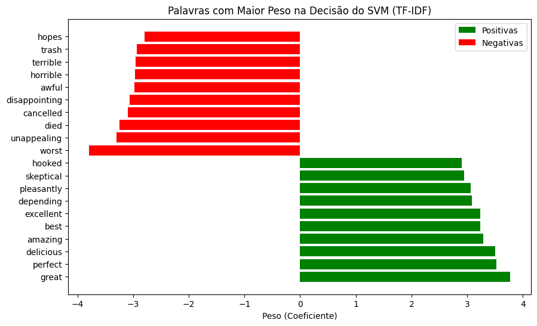

# Sentiment Analysis of Amazon Food Reviews

Binary sentiment classification (positive / negative) of Amazon food product reviews, comparing four generations of NLP approaches on the same test set: lexicon and rule-based models, classical machine learning, Transformers and LLMs.

Team project for the *Text Mining* course, MSc in Data Science, ISCTE (2025/26), developed with Afonso Abreu and Afonso Claudino.

## Approaches compared

- **Lexicon / rule-based:** TextBlob, VADER, Stanza, NRC EmoLex (with negation handling and valence shifting)
- **Classical ML:** Naive Bayes, Logistic Regression, SVM, Decision Tree, Random Forest, using Bag of Words, TF-IDF and Word2Vec features
- **Transformers:** DistilBERT (SST-2 off the shelf, and fine-tuned on the training set)
- **LLM:** GPT-4o (zero-shot and few-shot prompts, on a small sample)

## Results (selected)

| Model | Accuracy | Macro F1 |
|---|---|---|
| VADER | 0.79 | 0.71 |
| Naive Bayes, BoW, 10K features, negation | 0.85 | 0.83 |
| Logistic Regression, TF-IDF, 5K features | 0.84 | 0.83 |
| SVM, TF-IDF, 15K features, negation | 0.86 | 0.84 |
| DistilBERT, fine-tuned (3 epochs) | **0.92** | **0.91** |
| GPT-4o, zero-shot domain prompt* | 0.92 | 0.92 |

\*GPT-4o was evaluated on a much smaller sample because of API cost and rate limits.

Macro F1 was used as the main metric because the dataset is imbalanced (about 70% positive reviews), so accuracy alone hides poor performance on the negative class.

**Takeaway:** fine-tuned DistilBERT gave the best trade-off between accuracy and cost. A linear SVM with TF-IDF and negation handling stayed surprisingly competitive at a fraction of the compute.



## Repository structure

```
sentiment_analysis.ipynb   # full pipeline: preprocessing, models, evaluation
data/                      # train and test reviews (amazon_reviews_train.csv, amazon_reviews_test.csv)
report_en.pdf              # full written report (English)
report_pt.pdf              # original report (Portuguese)
requirements.txt           # Python dependencies
```

## How to run

```bash
pip install -r requirements.txt
jupyter notebook sentiment_analysis.ipynb
```

Open the notebook from the repository folder; it reads the data from `data/`. The notebook keeps its outputs, so the results can be read without re-running it.

Two parts need something that is not in the repository:
- The NRC EmoLex section uses the NRC Word-Emotion Association Lexicon. The copy used in the project is no longer available to me, so it is not included. It can be requested from its authors at the [NRC Emotion Lexicon page](https://saifmohammad.com/WebPages/NRC-Emotion-Lexicon.htm) and saved as `data/NRC-lexicon.csv`. The rest of the notebook runs without it, and the saved outputs show the original results.
- The GPT-4o experiments need an OpenAI API key.

Fine-tuning DistilBERT is much faster on a GPU.

## Tech stack

Python · pandas · scikit-learn · NLTK · Stanza · Gensim · Hugging Face Transformers · PyTorch

## Team

André Marques, Afonso Abreu and Afonso Claudino. The full report with the team's methodology and discussion is in [`report_en.pdf`](report_en.pdf) (English) and [`report_pt.pdf`](report_pt.pdf) (original, Portuguese).
